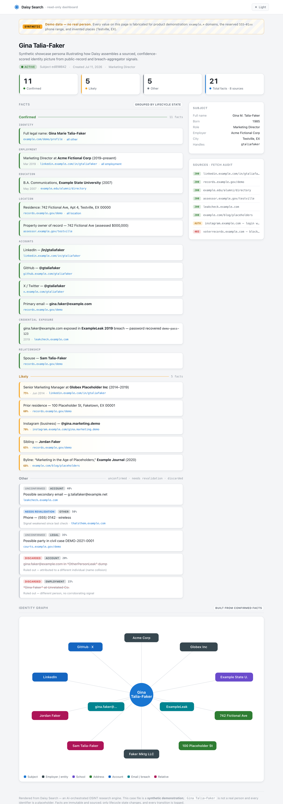
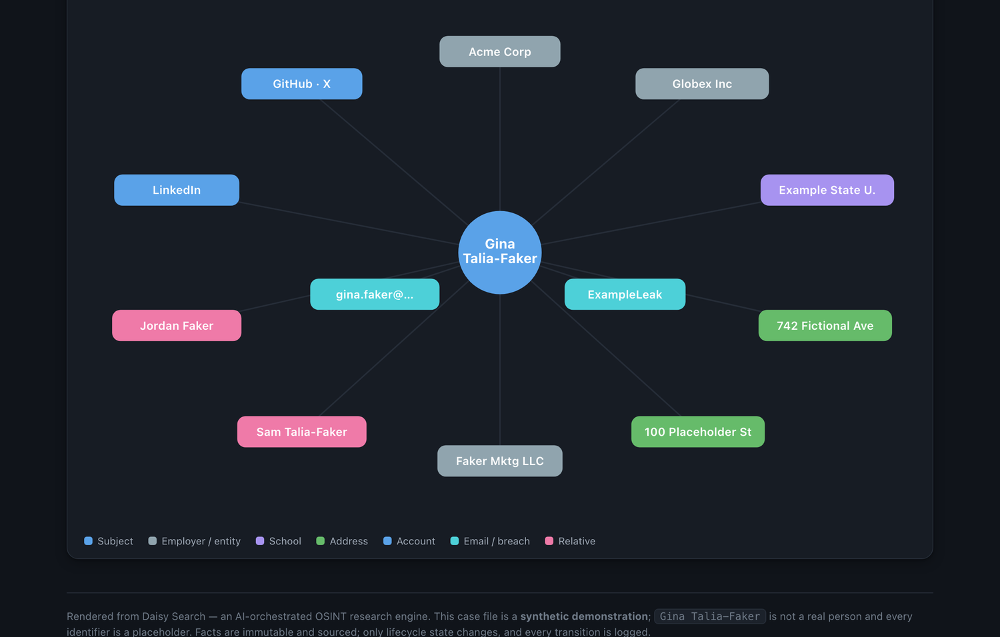

<div align="center">

# 🌼 Daisy Search

**An AI-orchestrated OSINT research engine.**

Point a Claude agent at a name. It plans the investigation, runs the searches, fetches the pages,
extracts structured facts, scores them, cross-links them into an identity graph — and remembers
everything across sessions in a shared Postgres brain.

[](https://www.python.org/)
[](https://fastapi.tiangolo.com/)
[](https://www.postgresql.org/)
[](https://neo4j.com/)
[](https://modelcontextprotocol.io/)
[](https://docs.astral.sh/uv/)
[](LICENSE)

</div>

---

## What it is

Daisy is not a script you run — it's a **toolbox an AI agent drives.** It plugs into Claude Code or
Claude Desktop as a [Model Context Protocol](https://modelcontextprotocol.io/) server. The agent is the
investigator; Daisy is the lab. The agent decides *what* to look for and *when* to trust it; Daisy handles
search, retrieval, extraction, persistence, and graphing — and enforces the discipline that keeps a
messy OSINT trail honest.

```
        ┌──────────────────────────────────────────────┐
        │   Claude Code / Desktop  (the investigator)   │
        │   plans · reasons · decides what to trust     │
        └───────────────────────┬──────────────────────┘
                     MCP tools   │   (18 of them)
        ┌───────────────────────▼──────────────────────┐
        │            Daisy MCP Server (the lab)         │
        │  search · fetch · extract · fact · graph      │
        └───┬───────────┬───────────┬───────────┬──────┘
            │           │           │           │
      ┌─────▼────┐ ┌────▼─────┐ ┌───▼────┐ ┌────▼─────┐
      │ Postgres │ │  Neo4j   │ │ SearXNG│ │ crawl4ai │
      │  (brain) │ │ (graph)  │ │(search)│ │ (fetch)  │
      └──────────┘ └──────────┘ └────────┘ └──────────┘
                    ▲
        ┌───────────┴───────────┐
        │  Web dashboard (RO)   │  read-only view of the case file
        └───────────────────────┘
```

## See it in action

> **Note —** the case file below is a **synthetic demo persona.** `Gina Talia-Faker` is not a real
> person — every value is fabricated (`example.*` domains, the reserved `555-01xx` phone range,
> invented places like *Testville, EX*).

The read-only dashboard presents each subject as a **case file**: facts grouped by lifecycle state,
every one scored and traceable to its source, with a per-source **fetch audit** (including blocked
and auth-walled pages).

<p align="center">
  
</p>

Confirmed facts are cross-linked and de-duplicated into a navigable **identity graph** —
people, employers, addresses, accounts, and exposures around the subject at a glance:

<p align="center">
  
</p>

## Why it's different

- **Agent-native.** Everything is an MCP tool. No brittle scraping DAGs — the model orchestrates,
  branches, and backtracks in natural language.
- **Facts are immutable & sourced.** Every claim is a permanent, timestamped record tied to its source.
  Nothing is silently edited. Only a fact's *lifecycle state* changes, and every transition is logged.
- **Built-in skepticism.** Findings require converging signals before promotion. A single noisy
  people-search hit doesn't become truth.
- **A shared brain across sessions.** Close the laptop, come back tomorrow — the case is exactly where
  you left it, in Postgres.
- **Fetch audit trail.** Every retrieval attempt is recorded (success, block, auth-wall), so you always
  know what was actually seen versus assumed.
- **Identity graph.** Entities, addresses, employers, and accounts are de-duplicated and linked into a
  navigable Neo4j graph.

## How it compares

The agent-native OSINT space is getting crowded. Daisy's bet is different from most of it:
the hard part isn't *collecting* more, it's knowing **what you actually saw** afterwards.

| | Daisy | [OpenOSINT](https://github.com/OpenOSINT/OpenOSINT) | [SpiderFoot](https://github.com/smicallef/spiderfoot) | [BBOT](https://github.com/blacklanternsecurity/bbot) |
|---|---|---|---|---|
| Agent-native (MCP) | ✅ | ✅ | ❌ | ❌ |
| State across sessions | ✅ Postgres | ❌ session files | ✅ scan DB | ✅ scan DB |
| Immutable, sourced facts | ✅ | ❌ | ❌ | ❌ |
| Explicit fact lifecycle | ✅ | ❌ | ❌ | ❌ |
| Fetch audit (seen vs. assumed) | ✅ | ❌ | ❌ | ❌ |
| Identity graph | ✅ Neo4j | partial | ❌ | ❌ |
| Collection breadth | modest | ✅ 19 tools | ✅ 200+ modules | ✅ recursive |

If you want maximum surface area on a target, OpenOSINT and SpiderFoot wrap far more collectors.
Daisy is for the case where the finding has to hold up later — where "we never retrieved that page,
it was behind a login" is a fact worth recording, not a gap to paper over.

## The fact lifecycle

Every discovered claim is an immutable record that moves through states — it is never deleted or rewritten:

```
   unconfirmed ──▶ likely ──▶ confirmed
        │            │
        └────────────┴──▶ discarded
                     └──▶ needs_revalidation ──▶ (re-enters the pipeline)
```

## The toolbox

The agent works entirely through these MCP tools, all scoped to the active project:

| Area | Tools |
|------|-------|
| **Projects** | `daisy_projects` · `daisy_new_project` · `daisy_switch_project` · `daisy_archive_project` |
| **Discovery** | `daisy_intake` · `daisy_search` · `daisy_fetch` · `daisy_extract` · `daisy_fetch_clean`† |
| **Fetch audit** | `daisy_fetch_log` · `daisy_fetch_summary` |
| **Facts** | `daisy_add_fact` · `daisy_facts` · `daisy_confirm` · `daisy_sources` |
| **Graph** | `daisy_build_graph` · `daisy_graph` |
| **Output** | `daisy_report` |

† `daisy_fetch_clean` is registered only when `CRAWL4AI_URL` is set.

The methodology guide ships as an MCP resource at `daisy://methodology`, so the agent onboards itself.

For a single lead you just want to size up, there's a **quick-scan** mode — no project, no database
writes, results displayed and discarded. See [`QUICK_SCAN.md`](QUICK_SCAN.md).

## Quick start

**Prerequisites:** [UV](https://docs.astral.sh/uv/) · [Docker](https://www.docker.com/)

```bash
# 1. Bring up the stack (Postgres · Redis · Neo4j · SearXNG · crawl4ai)
docker compose up -d

# 2. Install dependencies
uv sync

# 3. Configure and migrate (defaults match the compose stack;
#    set at least one search backend or discovery returns nothing)
cp .env.example .env
uv run alembic upgrade head

# 4a. Run as an MCP server (for Claude Code / Desktop)
uv run daisy-mcp

# 4b. …or open the read-only dashboard
uv run uvicorn daisy.api.app:app --reload   # http://localhost:8000
```

Then register the server with your Claude client and say: *"Start a new search for …"*

## Tech stack

| Layer | Tech |
|-------|------|
| Orchestrator | Claude Code / Claude Desktop (via MCP) |
| Tool server | Python 3.11 · [MCP](https://modelcontextprotocol.io/) |
| API / dashboard | FastAPI · Uvicorn · Jinja2 |
| Persistence | PostgreSQL (async, asyncpg) · SQLAlchemy 2.x · Alembic |
| Identity graph | Neo4j |
| Search / fetch | SearXNG · crawl4ai · trafilatura |
| Queue (optional batch) | Redis · RQ |
| Packaging | UV |

## Development

```bash
uv run ruff check .           # lint (Alembic revision files excluded)
uv run pytest                 # tests (tool registry, auth-wall detection, lifecycle constants)
uv run alembic revision --autogenerate -m "…"   # new migration
docker exec -it daisy-postgres psql -U daisy -d daisy   # DB shell
```

## Project layout

```
src/daisy/
├── mcp_server.py     # all research tools live here
├── constants.py      # enums, magic strings, defaults
├── config.py         # pydantic-settings (env-driven)
├── graph.py          # identity graph construction
├── models/           # SQLAlchemy ORM (project · subject · fact · source · fetch_attempt · …)
├── api/              # read-only FastAPI dashboard
└── web/              # templates & static assets
migrations/           # Alembic
templates/            # per-case workspace scaffolding
scripts/              # LeakCheck lookup, report + graph generators, workspace bootstrap
projects/  searches/  # per-case workspaces — git-ignored, hold investigation data
```

## Responsible use

Daisy is built for **legitimate, authorized work** — auditing your own footprint, consented
research, journalism, and security work — using only **public records, published reporting, and
breach-aggregator data.** It does not defeat authentication, evade access controls, or use recovered
credentials, and it is not for surveillance, stalking, or harassment. An auth wall is a stopping
point, recorded as `auth_wall` in the fetch log — not an obstacle to route around. You are
responsible for complying with all applicable laws and platform terms in your jurisdiction.

The full scope boundary, including what counts as a security issue in a tool that handles other
people's data, is in [SECURITY.md](SECURITY.md).

## Contributing

Setup, conventions, and the rules that keep the audit trail honest are in
[CONTRIBUTING.md](CONTRIBUTING.md). Run `uv run ruff check .` and `uv run pytest -q` before
opening a PR — CI runs both, plus a guard that fails if investigation data or a local absolute
path is ever committed.

## License

[MIT](LICENSE).
